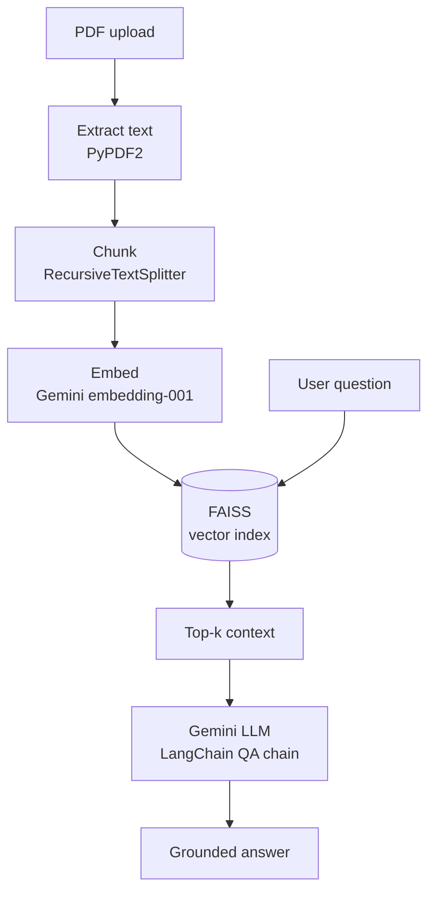

<p align="center">
  
</p>

<p align="center">
  <a href="https://www.linkedin.com/in/pranith-manuri-578876233"></a>
  <a href="mailto:pranithmanuri07@gmail.com"></a>
  
</p>

<br>

### `$ whoami`

```python
class PranithManuri(AIEngineer):
    location   = "Hyderabad, India"
    role       = "AI Engineer"
    builds     = ["RAG systems", "LLM-powered apps", "GenAI interfaces"]
    llm_stack  = ["LangChain", "Google Gemini", "FAISS", "Embeddings"]
    languages  = ["Python", "JavaScript", "TypeScript"]
    ships_with = ["React", "Streamlit", "Node.js", "Vercel"]

    def philosophy(self):
        return "Models are only useful when people can trust the answers and enjoy the interface."
```

<br>

### `$ cat featured_project.md`

<table>
<tr>
<td width="55%" valign="top">

#### [PDF Insight Engine](https://github.com/Pranith07-coder/PDF-Insight-Engine)

Chat with your documents. Upload PDFs, ask questions in plain language, and get answers grounded in what the documents actually say.

- Recursive chunking keeps context intact across pages
- Gemini embeddings indexed in **FAISS** for fast similarity search
- A **LangChain** QA chain with a custom prompt answers only from retrieved context
- Wrapped in a clean **Streamlit** interface

`Python` `LangChain` `Gemini` `FAISS` `Streamlit`

</td>
<td width="45%" valign="top">



</td>
</tr>
</table>

<br>

### `$ ls ./projects`

<table>
<tr>
<td width="50%" valign="top">

**[Gemini Clone](https://github.com/Pranith07-coder/Gemini-clone)**<br>
<sub>Conversational AI on the Google Gemini API with a responsive React chat UI.</sub><br>
<a href="https://gemini-clone-com.vercel.app/">Live demo</a> · `React` `Gemini API`

</td>
<td width="50%" valign="top">

**[Statistics Calculator](https://github.com/Pranith07-coder/Statistics-Calculator)**<br>
<sub>Descriptive statistics, probability and hypothesis testing, computed instantly in the browser.</sub><br>
<a href="https://statisticscalculatorcom.netlify.app/">Live demo</a> · `JavaScript`

</td>
</tr>
<tr>
<td width="50%" valign="top">

**[Bookwave](https://github.com/Pranith07-coder/Bookwave-E-Commerce_Book_Store)**<br>
<sub>Full-stack e-commerce platform for books with search and product browsing.</sub><br>
`MongoDB` `Express` `React` `Node.js`

</td>
<td width="50%" valign="top">

**[Resumegen](https://github.com/Pranith07-coder/Resumegen)**<br>
<sub>Resume builder with live editing and customizable templates.</sub><br>
<a href="https://resumegen7.vercel.app/">Live demo</a> · `React`

</td>
</tr>
<tr>
<td width="50%" valign="top">

**[Movie Search](https://github.com/Pranith07-coder/Movie-Search)**<br>
<sub>Find films, shows and actors with cast, ratings and trailers.</sub><br>
<a href="https://moviesearchcom.vercel.app/">Live demo</a> · `JavaScript`

</td>
<td width="50%" valign="top">

**[CaféHunt](https://github.com/Pranith07-coder/Cafe-Hunt)**<br>
<sub>Helps remote workers find cafés with reliable Wi-Fi.</sub><br>
<a href="https://cafe-hunt.vercel.app">Live demo</a> · `HTML` `CSS` `JavaScript`

</td>
</tr>
</table>

<br>

### `$ pip list --toolkit`

<p>
  
</p>

<p>
  
  
  
  
  
  
</p>

<br>

### `$ ./contact.sh`

```bash
echo "Let's build something intelligent together."
# email     → pranithmanuri07@gmail.com
# linkedin  → linkedin.com/in/pranith-manuri-578876233
# status    → open to AI engineering roles and LLM / RAG collaborations
```

<p align="center">
  <sub>Thanks for stopping by.</sub>
</p>
